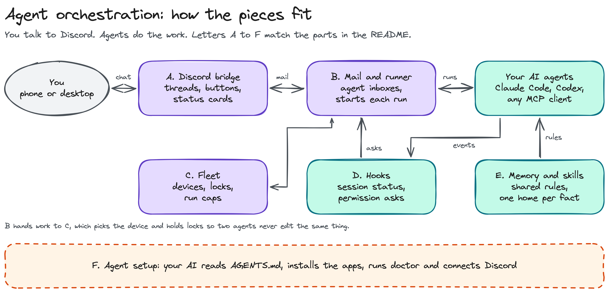

# Agent Switchboard

Run a small team of AI coding agents on your own computers and steer them from Discord.

You type a request on your phone. An orchestrator agent plans it, hands a task to a builder, checks the result and
answers you in the same thread, asking with buttons when a decision is yours. It works across more than one
computer, keeps two agents from editing the same thing, and needs nothing but Python and the agent CLIs you
already use.



- **Your subscriptions, your machines.** It starts the Claude Code CLI (and optionally Codex) that you are already
  signed in to. No API keys, no server, no hosted service.
- **Standard library only.** Every script is plain Python 3.11+ with no packages. Built and used on macOS and Windows;
  the tests also run on Linux.
- **Discord is optional.** Everything is files in one shared folder, so the same work can be driven from a terminal.
- **Set up by your AI.** [AGENTS.md](AGENTS.md) tells a coding agent how to install and check everything, and marks
  the few steps only you can do.

## Quick start

The easy way: open Claude Code (or any coding agent) in an empty terminal and say:

> Clone https://github.com/RemielDev/agent-switchboard into the folder that holds my projects, read its AGENTS.md
> and set it up for me.

By hand:

```
cd ~/Developer                      # the folder that holds your project folders: this becomes the "root"
git clone https://github.com/RemielDev/agent-switchboard.git
cd agent-switchboard
python3 setup/doctor.py --fix       # creates <root>/Queue, installs role files, registers the agents
python3 switchboard/mail-runner.py --mcp      # the agents: leave it running
```

Then either connect Discord ([docs/discord-setup.md](docs/discord-setup.md), ten minutes) and run
`python3 switchboard/discord-bridge.py run`, or try it from a second terminal without Discord:

```
python3 switchboard/agent-mail.py send --from <device-agent> --to orchestrator --subject "Hello" --body "List the repos you can see." --needs-reply
python3 switchboard/agent-mail.py inbox <device-agent>
```

(`<device-agent>` is the mailbox the doctor made for your own sessions on this device; it prints the name.)

## The parts

Letters match the diagram. Everything lives in [`switchboard/`](switchboard) as flat, readable scripts.

### A. Discord bridge

`discord-bridge.py` turns agent mail into Discord and back; agents never see Discord. Each request in
`#orchestrator` becomes a thread with one status message edited in place, the agents' answers, questions as
buttons and files. `#progress` and `#overview` show everything in flight. Only the server owner is obeyed.
Optional small-model helpers (`triage.py`, `discord-janitor.py`) answer status questions without starting an agent
and keep the server tidy. Tested against a fake Discord: no token or network needed to run the tests.

### B. Mail and runner

`agent-mail.py` gives every agent an inbox: one JSON file per message under `Queue/mail/<agent>/`, with explicit
acknowledgement, threads and hop counts. `agent-mail-mcp.py` exposes it to any MCP client as tools (`send_message`,
`ask_owner`, `list_active_work` and more). `mail-runner.py` watches the inboxes of the automatic agents and starts
a headless Claude Code or Codex run for each message, in the right repo folder, with the agent's role text, your
notes for that thread, and the project's memory. After a build it measures what really changed, runs the plan's
`CHECK:` commands and attaches the results, so the reviewer reads facts instead of the builder's summary.
`route.py` picks the model and effort for each run from a rules table you can edit.

### C. Fleet

`fleet.py` keeps a heartbeat per device and the shared progress log, picks the device for each run, and merges
state written on two machines. The runner holds a claim so only **one writer works in a repo or named area at a
time**, across all devices, while unrelated work runs side by side. A message you type never waits behind
agent-to-agent mail. `housekeeper.py` keeps a Windows worker light. A `Queue/STOP` file pauses everything.

### D. Hooks

`session-hook.py` records your own interactive Claude Code and Codex sessions so they show up beside the agents'
work. `permission-hook.py` forwards a permission request to you with Allow once and Deny buttons when you are
away from the keyboard, and never approves anything by itself.

### E. Memory and skills

`claude-memory-loader.py` feeds every session, interactive or unattended, the `MEMORY.md` rule files that apply
to the folder it works in, from one shared vault of Markdown notes: one home per fact.
`setup/skills-sync.sh` keeps one shared folder of agent skills linked into Claude Code, Codex and Cursor.
See [docs/memory-and-skills.md](docs/memory-and-skills.md).

### F. Agent setup

[AGENTS.md](AGENTS.md), `setup/doctor.py` (check and fix), `setup/autostart.py` (start at login, on request) and
the files under [`templates/`](templates): role texts for the orchestrator, builder and reviewer, config defaults,
login items and a starter memory vault.

### Also in the box

- **Improvement loop** (`improve-loop.py`): on a schedule, hands the orchestrator one improvement cycle for each
  project you added: start from evidence, make one change, record the metric it should move, check it later.
- **Queue runner** (`queue-runner.py`): runs Markdown task cards from `Queue/todo` one at a time.
- **Notepad, playbook, retro** (`notes.py`, `playbook.py`, `retro.py`): everything you wrote in a thread reaches
  every agent in order; short per-project lessons feed the planner; a weekly summary of what the runs cost.

## How a request flows

1. You type in `#orchestrator`. The bridge opens a thread on your message and mails the orchestrator.
2. The runner starts the orchestrator in the right folder. For real work it reads the code, writes a full plan and
   mails `builder` one task that ends with `CHECK:` lines.
3. The runner starts the builder under a claim on that repo, then measures the diff and runs the checks.
4. The orchestrator reviews the measured result, asks for one fix, calls a full review for risky work, or reports.
5. A decision that is yours arrives as buttons in the thread; your tap, or anything you type, continues the work.

More in [docs/how-it-works.md](docs/how-it-works.md).

## Documentation

| | |
|---|---|
| [AGENTS.md](AGENTS.md) | Setup instructions written for an AI agent |
| [docs/how-it-works.md](docs/how-it-works.md) | The components, the shared folder and the life of a request |
| [docs/discord-setup.md](docs/discord-setup.md) | Creating the bot, the channels, what you can type |
| [docs/configuration.md](docs/configuration.md) | Every config file, key, flag and environment variable |
| [docs/multi-device.md](docs/multi-device.md) | Running on two or more computers |
| [docs/memory-and-skills.md](docs/memory-and-skills.md) | Shared rules and shared skills |
| [docs/design-decisions.md](docs/design-decisions.md) | Why it is built this way, and what was tried and rejected |
| [SECURITY.md](SECURITY.md) | What you are trusting, and what the code enforces |

## Safety in one paragraph

The agents run as you, with the permission mode you choose (default `acceptEdits`). The bridge obeys only the
owner of your Discord server. The bot token stays in a file on your device and never enters the shared folder.
Agents cannot answer their own questions as you through the mail CLI, and risky buttons are never pressed on your
behalf. Read [SECURITY.md](SECURITY.md) before running it unattended.

## Tests

```
python3 switchboard/discord-bridge-test.py            # bridge and runner against a fake Discord, about 10 minutes
python3 switchboard/discord-bridge-test.py archived   # only tests whose name contains "archived"
python3 switchboard/concurrency-test.py               # runner slots, claims and lock races
python3 switchboard/route-test.py                     # model routing rules
python -m pytest tests -q                             # unit tests
python3 tools/check-clean.py                          # no secrets or machine-specific details
```

Nothing in the tests touches a real Discord server, your token or your live `Queue/`.

## Status

This is a working system extracted from daily use and generalised. It is opinionated and young: expect to read
some code. Issues and pull requests are welcome; see [CONTRIBUTING.md](CONTRIBUTING.md).

## License

[MIT](LICENSE)
